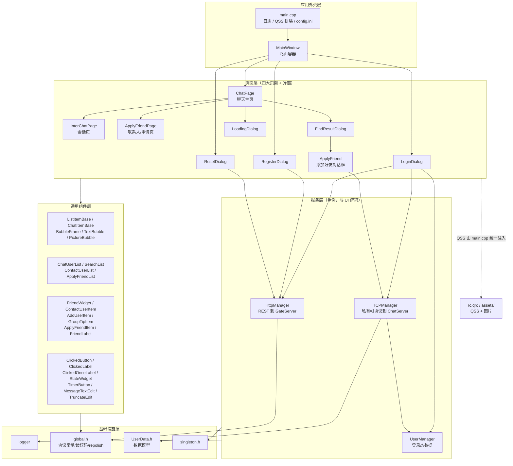
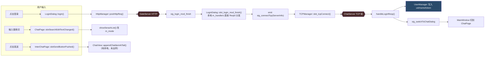
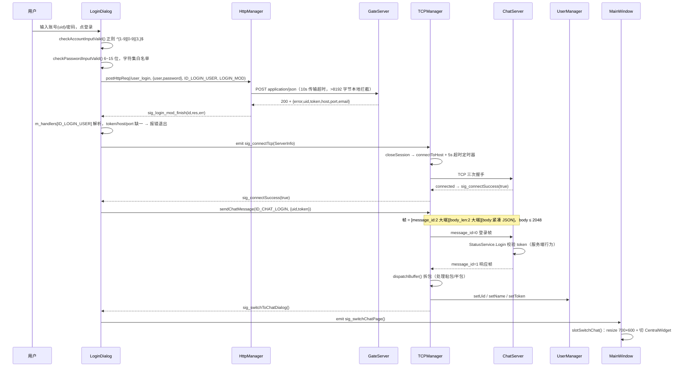
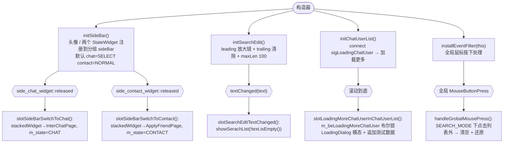

# MyChat 客户端（qtClient）架构说明文档

> 适用版本：主干（`main`）截至 2026-10-06  
> 工程：`C:\dev\MyChat\qtClient\ChatClient.vcxproj`  
> 目标：C++20 / Qt 6.11.2 Widgets，Windows x64，Visual Studio 2022 构建
>
> 本文档描述的是**当前代码的实际行为**（而非设计意图）。凡与注释/UI 描述不一致处，一律以源码为准并在文末「已知约束与技术债」中标注。

---

## 目录

1. [项目概览](#1-项目概览)
2. [目录结构说明](#2-目录结构说明)
3. [整体架构分层与模块依赖](#3-整体架构分层与模块依赖)
4. [前端（UI）部分](#4-前端ui-部分)
   - 4.1 [页面路由](#41-页面路由)
   - 4.2 [布局结构](#42-布局结构)
   - 4.3 [组件划分](#43-组件划分)
   - 4.4 [状态管理](#44-状态管理)
   - 4.5 [样式方案](#45-样式方案)
   - 4.6 [核心页面交互逻辑](#46-核心页面交互逻辑)
5. [网络与数据层](#5-网络与数据层)
6. [构建与运行](#6-构建与运行)
7. [配置与环境变量](#7-配置与环境变量)
8. [已知约束与技术债](#8-已知约束与技术债)
9. [附录：关键文件索引](#9-附录关键文件索引)

---

## 1. 项目概览

### 1.1 一句话定义

MyChat 聊天系统的 **Qt Widgets 桌面客户端**：通过 HTTP 与 GateServer 完成注册/登录/找回密码，再按登录响应分配到的 ChatServer 建立裸 TCP 长连接完成登录握手；聊天会话 UI 已成型，收发消息目前以本地自测按钮驱动，尚未对接服务端的聊天转发协议。

### 1.2 技术栈

| 项          | 取值                                                     | 出处                                              |
| ---------- | ------------------------------------------------------ | ----------------------------------------------- |
| 语言标准       | `stdcpp20`                                             | `ChatClient.vcxproj` → `<LanguageStandard>`     |
| Qt 版本      | `6.11.2_msvc2022_64`                                   | `ChatClient.vcxproj` → `<QtInstall>`            |
| Qt 模块      | `core;gui;widgets;network`                             | `ChatClient.vcxproj` → `<QtModules>`            |
| 工具集        | `v145`（VS2022 平台工具集）                                   | `ChatClient.vcxproj` → `<PlatformToolset>`      |
| 构建配置       | `Debug\|x64`、`Release\|x64`                            | `ChatClient.vcxproj` → `<ProjectConfiguration>` |
| 字符集 / 编译选项 | `Unicode`、`/utf-8`                                     | `ChatClient.vcxproj`                            |
| 构建系统       | **仅 MSBuild**（`.vcxproj` + `.slnx`），**无 CMakeLists**   | 仓库根目录                                           |
| 字符编码       | 源码 UTF-8 with BOM 为主，QString 未加 `tr()` 的中文串依赖 `/utf-8` | 见 §8 §T14                                       |

### 1.3 服务端对照

客户端依赖三个后端服务，接口契约文档在 `docs/ServerDocs/`（该目录被 `.gitignore` 忽略，仅本地可见）：

| 服务                          | 协议         | 客户端对应实现                                   |
| --------------------------- | ---------- | ----------------------------------------- |
| GateServer                  | HTTP JSON  | `httpmanager.cpp`                         |
| ChatServer                  | 私有 TCP 帧协议 | `TCPManager.cpp`                          |
| StatusServer / VerifyServer | gRPC       | 客户端**不直连**，由 GateServer / ChatServer 内部调用 |

报文字段与错误码的权威定义在 `docs/ServerDocs/api-http.md`、`api-tcp.md`、`error-codes.md`；客户端侧的常量镜像在 `global.h` 并已在注释里标注了对应关系。

---

## 2. 目录结构说明

仓库采用**扁平源码结构**（工程根目录即 include root，`*.ui` / `*.h` / `*.cpp` 同级），没有 `src/` 分层。下面按职责逐层说明。

```
C:/dev/MyChat/qtClient/
├── ── 入口与应用外壳 ──────────────────────────────────────
│   main.cpp              程序入口：安装日志 → 拼装 QSS → 读 config.ini → 起 MainWindow
│   mainwindow.h/.cpp/.ui 唯一主窗口 QMainWindow，充当「路由容器」（见 §4.1）
│   resource.h            VS 资源头（旧 Windows 资源体系残留）
│   ChatClient.rc         VS 资源脚本（图标 / 版本信息）
│   ChatClient.aps        VS 资源编辑器二进制中间文件（已 gitignore）
│
├── ── 认证链路页面（三个平级「全屏页」）──────────────────
│   logindialog.h/.cpp/.ui       登录页（QDialog）
│   registerdialog.h/.cpp/.ui    注册页（内含 QStackedWidget 两步：表单 → 成功）
│   resetdialog.h/.cpp/.ui       重置密码页
│   timer_button.h/.cpp          TimerButton：验证码倒计时按钮
│
├── ── 聊天主容器层 ────────────────────────────────────────
│   chatpage.h/.cpp/.ui          聊天主页：侧边栏 + 会话/联系人列表 + QStackedWidget 右区
│   chatview.h/.cpp/.ui          消息区滚动容器（QScrollArea + QVBoxLayout）
│   interchatpage.h/.cpp/.ui     单人会话页：标题 + ChatView + 输入区
│   chatitembase.h/.cpp/.ui      一条消息的容器（头像 + 名字 + 气泡占位）
│   bubbleframe.h/.cpp/.ui       气泡外框（自绘边框）
│   TextBubble.h/.cpp            文本气泡
│   PictureBubble.h/.cpp         图片气泡
│   MessageTextEdit.h/.cpp       支持回车发送、拖拽/粘贴文件的输入框，产出 QVector<MessageInfo>
│   TruncateEdit.h/.cpp          带长度截断的 QLineEdit（失焦时省略过长文本）
│
├── ── 列表与列表项（左侧三个列表 + 复用项组件）───────────
│   ListItemBase.h               所有列表项的基类，提供 ListItemType 类型标记 + QSS 生效的 paintEvent
│   ChatUserList.h/.cpp          会话列表（QListWidget 子类），滚动到底发 sigLoadingChatUser
│   SearchList.h/.cpp            搜索结果列表，内含 FindResultDialog
│   ContactUserList.h/.cpp       联系人列表（分组提示 + 新的朋友 + 联系人）
│   friendwidget.h/.cpp/.ui      会话列表项（头像 + 名字 + 时间 + 摘要）
│   ContactUserItem.h/.cpp/.ui   联系人列表项（头像 + 红点 + 名字 + 说明）
│   adduseritem.h/.cpp/.ui       搜索列表中的「添加用户」提示项
│   GroupTipItem.h/.cpp/.ui      列表分组标题项（如「联系人」）
│   ApplyFriendList.h/.cpp       好友申请列表（QListWidget 子类）
│   ApplyFriendItem.h/.cpp/.ui   好友申请项（头像 + 名字 + 说明 + 同意按钮/状态文本）
│   FriendLabel.h/.cpp/.ui       好友标签胶囊（可删除）
│
├── ── 联系人页与添加好友弹窗 ──────────────────────────────
│   ApplyFriendPage.h/.cpp/.ui   联系人主页右侧页：好友申请列表
│   ApplyFriend.h/.cpp/.ui       添加好友对话框：验证消息 / 备注 / 标签录入（无边框 + 圆角遮罩）
│   findresultdialog.h/.cpp/.ui  搜索到用户后的结果卡片，点击「添加好友」拉起 ApplyFriend
│   loadingdialog.h/.cpp/.ui     加载中遮罩（GIF）
│
├── ── 基础自定义控件 ──────────────────────────────────────
│   ClickedButton.h/.cpp         带 normal/hover/press 三态换图的 QPushButton
│   clicked_label.h/.cpp         ClickedLabel：可点击 QLabel，六态（普通/选中 × 普通/悬停/按下）
│   ClickedOnceLabel.h/.cpp      仅响应单次点击的 QLabel（用于标签提示）
│   StateWidget.h/.cpp           侧边栏按钮：六态 + 红点 + clicked/released 信号
│
├── ── 网络与数据 ──────────────────────────────────────────
│   httpmanager.h/.cpp           GateServer HTTP 单例
│   TCPManager.h/.cpp            ChatServer 裸 TCP 单例（封帧 / 拆帧 / 分发）
│   UserManager.h/.cpp           当前登录用户信息单例
│   UserData.h                   数据模型：SearchInfo / ApplyInfo / AuthInfo / AuthRsp / UserInfo
│   global.h/.cpp                协议常量、错误码、全局变量 GATE_URL_PREFIX、repolish
│   singleton.h                  CRTP 单例模板 Singleton<T>
│   logger.h/.cpp                统一日志（级别、格式、编译期裁剪）
│
├── assets/                      ★ 静态资源
│   ├── images/                  30 个 PNG（三态按钮图标）+ 5 张 JPG 头像 + 1 个 GIF loading
│   └── styles/                  11 个 QSS，按「页面 / 组件」分目录（见 §4.5）
├── static/                      ★ 运行时从 exe 同级目录读取的图片（findresultdialog.cpp:20）
├── rc.qrc                       Qt 资源清单，把 assets/images 与 assets/styles 打进二进制
│
├── docs/                        ★ 本地文档（被 .gitignore 忽略）
│   ├── ServerDocs/              服务端接口文档：README / api-http / api-grpc / api-tcp / error-codes / api-changes
│   └── spelling-review.md
│
├── ── 构建体系 ────────────────────────────────────────────
│   ChatClient.vcxproj           工程文件（含 Qt VS Tools 的 QtMoc/QtUic/QtRcc 项）
│   ChatClient.vcxproj.filters   VS 解决方案资源管理器的虚拟目录
│   ChatClient.vcxproj.user      本机用户配置（已 gitignore）
│   ChatClient.slnx              VS2022 新版解决方案文件，仅含 1 个工程 / 1 个平台 x64
│
├── x64/                         构建产物（gitignore）
│   ├── Debug/ChatClient.exe     另有 ChatClient.pdb、config.ini、static/
│   └── Release/ChatClient.exe   另有 config.ini
├── ChatClient/                  ★ 历史遗留：另一个 x64 产物目录，内容与 ./x64 重复
├── .vs/ .idea/                  VS / CLion 本机配置（gitignore）
├── config.ini                   运行时配置（见 §7）
├── ChatClient.vcxproj 同级的 .editorconfig / .gitignore
└── .workbuddy/                  工作区辅助数据
```

> **注意**：`ChatClient/` 目录是早期 CMake/CLion 时代的构建产物残留（内部只有 `x64/`），**不是**源码目录，容易与工程文件 `ChatClient.vcxproj` 混淆。

---

## 3. 整体架构分层与模块依赖

### 3.1 分层图



### 3.2 依赖原则与实际状况

| 原则                                              | 现状                                                                                                   |
| ----------------------------------------------- | ---------------------------------------------------------------------------------------------------- |
| UI 不直接发网络请求，统一走 `HttpManager` / `TCPManager` 单例 | ✅ 符合。所有网络出口仅这两个类                                                                                     |
| 下层不反向依赖上层，页面切换用信号回传到 `MainWindow`               | ✅ 符合（`switchRegister` / `sig_switchChatPage` / `sigSwitchLoginPage`）                                 |
| 单例通过 `Singleton<T>` 模板 + 私有构造获得                 | ✅ `HttpManager` / `TCPManager` / `UserManager`                                                       |
| 数据模型集中定义                                        | ✅ 全部在 `UserData.h`                                                                                   |
| 组件可复用                                           | ⚠️ 列表项通过 `ListItemBase::getType()` 分支处理，但 `SearchList` / `ContactUserList` 的点击事件各自 switch，**未抽公共策略** |
| UI 层不持有连接                                       | ⚠️ `LoginDialog` 同时承担「HTTP 登录 + TCP 连接 + 聊天服登录」三步，页面与协议流程耦合偏重（见 §8 T10）                              |

---

## 4. 前端（UI）部分

### 4.1 页面路由

项目**没有** router 抽象，路由由两级手工切换实现：

#### 一级路由：MainWindow 中央部件互斥替换

`mainwindow.cpp:24` 的 `switchPage()`：`setCentralWidget(page)` + 旧页 `hide()` + `deleteLater()`。

> 注释里明确写了为什么必须销毁旧页：旧页若保留，会继续响应 `HttpManager` / `TCPManager` 的**全局广播信号**，导致同一请求被多个页面重复处理（例如重复发起 TCP 连接）。

```mermaid
stateDiagram-v2
    [*] --> Login: MainWindow 构造立即调用 slotSwitchLogin()
    Login --> Register: LoginDialog::switchRegister
    Login --> Reset: LoginDialog::switchReset
    Register --> Login: sigSwitchLoginPage
    Reset --> Login: sigSwitchLoginPage
    Login --> ChatPage: LoginDialog::sig_switchChatPage<br/>(聊天服登录成功后)
    ChatPage --> Login: ChatPage::sigSwitchLoginPage
    note right of Login
        Debug 构建下 MainWindow 构造完
        立刻 slotSwitchChat() 直跳聊天页
        mainwindow.cpp:14-16
    end note
```

页面宽度约束也随路由变化（`mainwindow.cpp:79-125`）：

| 页面           | 窗口策略                            | 代码                          |
| ------------ | ------------------------------- | --------------------------- |
| 登录 / 注册 / 重置 | 固定 `350×500`（min = max = 初值）    | `slotSwitchLogin()` :79-81  |
| 聊天主页         | 最小 `650×500`，初始 `700×600`，可自由拉伸 | `slotSwitchChat()` :123-125 |

#### 二级路由：ChatPage 内 QStackedWidget

`chatpage.ui` 的 `stackedWidget` 有三页（`chatpage.ui`）：

| index | 对象名                 | 类                 | 状态               |
| ----- | ------------------- | ----------------- | ---------------- |
| 0     | `friend_apply_page` | `ApplyFriendPage` | 已实现              |
| 1     | `chat_page`         | `InterChatPage`   | 部分实现（本地收发）       |
| 2     | `friend_info_page`  | `QWidget`         | **空占位**，全仓库无代码引用 |

侧边栏按钮与列表联动切换（`chatpage.cpp:286-302`）：

- `side_chat_widget` → `slotSideBarSwitchToChat()` → index 1 + `m_state = CHAT_MODE` + 显示 `chat_users_list`
- `side_contact_widget` → `slotSideBarSwitchToContact()` → index 0 + `m_state = CONTACT_MODE` + 显示 `con_user_list`


> ⚠️ `ContactUserList` 自己也声明了 `sigSwitchApplyFriendPage()` / `sigSwitchFriendInfoPage()`（`ContactUserList.h:30-32`），但**全仓库没有任何 connect 接收方**——即点击联系人列表里的「新的朋友」目前**不会**切页，二级路由的唯一入口是侧边栏。详见 §8 T4。

#### 搜索态 Web 式浮层切换

除页面/栈切换外，`ChatPage` 还维护三个**平铺叠加**的列表（`chatpage.ui` 中它们同在 `chat_user_widget` 的布局里，靠 `show/hide` 互斥）：

```cpp
// chatpage.cpp:99  showSerachList()
is_searching        -> search_list 显示，m_mode = SEARCH_MODE
m_state == CHAT     -> chat_users_list 显示
m_state == CONTACT  -> con_user_list 显示
```

退出搜索态有三条路径：点击搜索框尾部的清除按钮（`chatpage.cpp:149-155`）、清除按钮触发 `textChanged` 走 `slotSearchEditTextChanged`、以及在 `ChatPage` 安装的全局事件过滤器里点击列表以外的区域（`chatpage.cpp:88-97, 209-222`）。

---

### 4.2 布局结构

#### 4.2.1 主窗口 → 聊天主页

```
MainWindow (QMainWindow, FramelessWindowHint)
└── centralWidget ← 运行时由 switchPage() 替换
    │
    └── ChatPage (QWidget)                          chatpage.ui
        ├── QHBoxLayout horizontalLayout
        ├── side_bar (QWidget)                      宽约 60，纵向
        │   └── QVBoxLayout verticalLayout
        │       └── widget (QWidget)
        │           └── QVBoxLayout verticalLayout_3
        │               ├── side_head_label (QLabel)     当前用户头像（硬编码 head_4.jpg）
        │               ├── side_chat_widget (StateWidget)    会话按钮，默认 SELECT
        │               └── side_contact_widget (StateWidget) 联系人按钮
        │
        ├── chat_user_widget (QWidget)              列表区（约 250 宽）
        │   └── QVBoxLayout verticalLayout_2
        │       ├── search_widget (QWidget)
        │       │   └── QHBoxLayout horizontalLayout_2
        │       │       ├── search_edit (TruncateEdit)   带 leading 放大镜 + trailing 清除
        │       │       └── add_button (ClickedButton)
        │       ├── chat_users_list (ChatUserList)   会话列表 ← 默认显示
        │       ├── search_list (SearchList)         搜索结果 ← 搜索态显示
        │       └── con_user_list (ContactUserList)  联系人列表 ← 联系人模式显示
        │
        └── stackedWidget (QStackedWidget)          右侧内容区
            ├── [0] friend_apply_page → ApplyFriendPage
            ├── [1] chat_page         → InterChatPage
            └── [2] friend_info_page  → QWidget（空占位）
```

> **列表区叠加而非换页**：三个 `QListWidget` 平铺在同一布局，靠 `show/hide` 切换。好处是切换零成本、保留滚动位置；代价是必须处处记得同步 `showSerachList()`，且三者会同时参与 `ChatPage` 的布局计算。

#### 4.2.2 会话页 InterChatPage

```
InterChatPage (QWidget)                             interchatpage.ui
└── QVBoxLayout verticalLayout
    ├── title_widget
    │   └── widget_4 → QHBoxLayout → title_label (QLabel)    对方名字
    ├── chat_data_list (ChatView)                            消息区，占据剩余空间
    ├── tool_widget
    │   └── QHBoxLayout
    │       ├── emoji_label (ClickedLabel)    表情（空实现）
    │       └── file_label (ClickedLabel)     文件（空实现）
    ├── chat_edit (MessageTextEdit)                          输入区
    └── button_widget (QWidget)  ← 运行期被 reparent 到 chat_edit 上并 raise()
        └── QHBoxLayout
            ├── receive_button (ClickedButton)   仅 CLIENT_DEBUG 下可见
            └── send_button (ClickedButton)
```

`interchatpage.cpp:45-51`：按钮区在构造时从布局里 `removeWidget` 后 `setParent(chat_edit)` + `raise()`，并在 `chat_edit` 上安装事件过滤器监听 `Resize` 以便 `updateButtonPos()` 重算右下角坐标。**原因**：若留在布局里，按钮容器会被拉伸成整块透明层，拦掉输入框的鼠标事件。

#### 4.2.3 消息区 ChatView

```
ChatView (QWidget)                                  chatview.ui
└── QVBoxLayout verticalLayout
    └── chat_area (QScrollArea, 纵向滚动条 ScrollBarAlwaysOn)
        └── scrollAreaWidgetContents (QWidget)
            └── QHBoxLayout horizontalLayout
                └── widget (QWidget)
                    └── QVBoxLayout verticalLayout_3
                        └── QVBoxLayout verticalLayout1   ← 消息插入点
                            └── null_widget (QWidget)     ← 底部弹簧占位
```

`ChatView::appendChatItemAtTail()`（`chatview.cpp:25`）在 `count()-1` 位置插入，把 `null_widget` 始终留在最后充当弹簧。`initScrollBar()`（:61）刻意用 `ScrollBarAlwaysOn`：注释记录了 Qt 6.11 下 `AsNeeded` 会导致滚动条出现时视口宽度变化、全部条目横向重排"弹一下"，而 overlay 滚动条方案在 Qt Widgets 上不可行。

#### 4.2.4 认证三页

```
LoginDialog (QDialog)                               logindialog.ui
└── QVBoxLayout verticalLayout_2
    └── QVBoxLayout verticalLayout
        ├── widget_2 → QGridLayout → error_tip (QLabel)   统一错误提示行
        ├── widget   → QGridLayout → img (QLabel)         品牌图
        ├── QHBoxLayout → account_label + account_edit (QLineEdit)
        ├── QHBoxLayout → pass_label + pass_edit (QLineEdit, Password)
        ├── QHBoxLayout → forget_label (ClickedLabel)     「忘记密码」
        ├── QHBoxLayout → login_button (QPushButton)
        └── QHBoxLayout → register_button (QPushButton)   「注册」

RegisterDialog (QDialog)                            registerdialog.ui
└── QVBoxLayout verticalLayout
    └── stackedWidget (QStackedWidget)         两步：page（表单）/ page_2（注册成功）
        ├── page: user_name / email / pass / pass2（各带 ClickedLabel 明文切换）
        │          token + get_token_button (TimerButton 倒计时)
        │          confirm_button / cancel_button
        └── page_2: reg_success_tip_label + return_to_login

ResetDialog (QDialog)                               resetdialog.ui
└── email / new_password / verify + get_verify_button + ok_button / cancel_button
```

#### 4.2.5 添加好友链路

```
FindResultDialog (QDialog, Frameless, modal)        findresultdialog.ui
└── QVBoxLayout
    ├── widget → head_label + name_label            搜索结果卡片
    └── widget_2 → add_friend_button (ClickedButton)
            │ 点击 → new ApplyFriend(m_parent); hide()   findresultdialog.cpp:42-47
            ▼
ApplyFriend (QDialog, Frameless)                    ApplyFriend.ui
└── QVBoxLayout verticalLayout
    ├── scrollArea → scrollcontents
    │   └── QVBoxLayout
    │       ├── apply_label + Line
    │       ├── verify_info_edit (TruncateEdit)     自定义验证消息
    │       ├── back_name_edit (TruncateEdit)       备注名
    │       ├── friend_group_widget
    │       │   └── QVBoxLayout
    │       │       ├── grid (QWidget)              ← 已选标签的容器，内部含 label_edit
    │       │       └── input_tip → tip_label (ClickedOnceLabel)  输入提示（"添加标签：xxx"）
    │       └── widget_2
    │           ├── label_list (QWidget)            ← 候选标签仓（隐藏/展开）
    │           └── more_label_widget → more_label (ClickedOnceLabel)  「更多标签」
    └── apply_sure_widget → sure_button / cancel_button
```

---

### 4.3 组件划分

按「是否被 `.ui` 提升（promote）使用」与复用粒度，分为四档：

#### 档一：基元控件（纯手绘状态，无 `.ui`）

| 组件                 | 基类          | 职责                                                                             | 文件                        |
| ------------------ | ----------- | ------------------------------------------------------------------------------ | ------------------------- |
| `ClickedButton`    | QPushButton | `normal/hover/press` 三套资源前缀，重写 enter/leave/press/release 换图                    | `ClickedButton.h/.cpp`    |
| `ClickedLabel`     | QLabel      | 六态（普通/选中 × 普通/悬停/按下）+ `clicked` 信号，用于「忘记密码」、眼睛图标、表情/文件按钮                       | `clicked_label.h/.cpp`    |
| `ClickedOnceLabel` | QLabel      | 单次触发，用于标签提示（避免连点重复添加）                                                          | `ClickedOnceLabel.h/.cpp` |
| `StateWidget`      | QWidget     | 侧边栏按钮：六态 + **红点**（`m_redPoint`）+ `clicked / clickedOnSelected / released` 三种信号 | `StateWidget.h/.cpp`      |
| `TimerButton`      | QPushButton | 获取验证码倒计时，防止连点刷验证码                                                              | `timer_button.h/.cpp`     |
| `MessageTextEdit`  | QTextEdit   | 回车发送（`sigSend`）、拖入/粘贴文件与图片、把内容拆成 `QVector<MessageInfo>`                        | `MessageTextEdit.h/.cpp`  |
| `TruncateEdit`     | QLineEdit   | 超长文本按字符宽度省略 + `sigFocusOut`                                                    | `TruncateEdit.h/.cpp`     |

> 这一档的共同手法：**手动 `setPixmap` 换图**，而不是用 QSS 的 `:hover` 伪状态。原因是 QSS 无法处理 QWidget 子类里复杂的位置/尺寸逻辑，而这类小控件数量多、状态简单，手绘换图在 Qt Widgets 下更可控。

#### 档二：列表项（继承 `ListItemBase`）

`ListItemBase.h` 定义了两件事：一是 `ListItemType` 枚举（8 种），二是**重写 `paintEvent` 手动调 `style()->drawPrimitive(PE_Widget)`** —— 这是 Qt Widgets 的经典坑：直接继承 `QWidget` 的自定义类不会自动应用 QSS 背景，必须自绘。

| 类型                              | 组件                           | 使用位置                                   |
| ------------------------------- | ---------------------------- | -------------------------------------- |
| `CHAT_USER`                     | `friendwidget.h/.cpp/.ui`    | 会话列表                                   |
| `CONTACT_USER` / `APPLY_FRIEND` | `ContactUserItem.h/.cpp/.ui` | 联系人列表（含红点、两种 `setInfo` 重载）             |
| `SEARCH_USER` / `ADD_USER_TIP`  | `adduseritem.h/.cpp/.ui`     | 搜索结果列表的「添加用户」项                         |
| `GROUP_TIP`                     | `GroupTipItem.h/.cpp/.ui`    | 分组标题（不可选中）                             |
| `INVALID`                       | —                            | 列表顶部 10px 空白占位（`SearchList.cpp:47-53`） |
| `APPLY_FRIEND`                  | `ApplyFriendItem.h/.cpp/.ui` | 好友申请列表                                 |
| `LINE`                          | —                            | 预留                                     |

列表容器档（`QListWidget` 子类）：

| 组件                | 特性                                                   | 文件                       |
| ----------------- | ---------------------------------------------------- | ------------------------ |
| `ChatUserList`    | `viewport()` 事件过滤器，滚动到底 emit `sigLoadingChatUser`    | `ChatUserList.h/.cpp`    |
| `SearchList`      | 内建 `FindResultDialog`；滚轮自定义步进；悬浮才显示滚动条               | `SearchList.h/.cpp`      |
| `ContactUserList` | 构造时塞好分组/新的朋友/联系人；滚轮到底 emit `sigLoadMoreContactUsers` | `ContactUserList.h/.cpp` |
| `ApplyFriendList` | 点击空白 emit `sigShowSearch`                            | `ApplyFriendList.h/.cpp` |

> 三个列表都实现了同一套「悬浮显示滚动条 + 自定义滚轮步进」逻辑，代码重复度很高（见 §8 T11）。

#### 档三：复合面板

`ApplyFriendPage`（申请列表容器）、`ChatView`（消息滚动容器）、`InterChatPage`（会话页）、`ChatPage`（主页）——都可被 `.ui` 提升（`chatpage.ui` 的 customwidgets 段里就有 `InterChatPage`、`ApplyFriendPage`、`ChatUserList`、`SearchList`、`ContactUserList`、`StateWidget`、`ClickedButton`、`TruncateEdit` 八个提升类）。

#### 档四：对话框

`LoginDialog` / `RegisterDialog` / `ResetDialog` / `FindResultDialog` / `ApplyFriend` / `LoadingDialog`。除 `ApplyFriend` 外都是「全页替换式」——被塞进 `MainWindow` 的 centralWidget 或独立弹出。

---

### 4.4 状态管理

项目**没有**引入 Redux 式的全局 store。状态分散在四处，各有明确边界：

<div align="center">

| 层级            | 载体                            | 内容                                                                  | 生命周期                  |
| ------------- | ----------------------------- | ------------------------------------------------------------------- | --------------------- |
| **会话态（全局唯一）** | `UserManager` 单例              | `uid / name / token / applyList`                                    | 进程级，登录后写入             |
| **连接态（全局唯一）** | `TCPManager` 单例内部 `LinkState` | `Idle / Connecting / Connected` + socket + 接收缓冲                     | 进程级                   |
| **页面自身状态**    | 页面私有成员                        | `m_state` / `m_mode` / `m_tipErrs` / `m_handlers` / `m_unauthItems` | 页面级（页面会被 deleteLater） |
| **视觉状态**      | QWidget 动态属性 + QSS            | `setProperty("state", "normal"\|"err")` 后 `repolish()` 重刷           | widget 级              |

</div>

#### 4.4.1 UserManager —— 唯一的"全局 store"

`UserManager.h:13` 继承 `QObject` + `Singleton<UserManager>`，持有四个字段。写入点只有一处：`TCPManager::handleLoginResp()`（`TCPManager.cpp:274-277`）在聊天服登录回包成功后 set 三个字段；`applyList` 目前**没有任何写入方**（只读容器，恒为空）。

#### 4.4.2 页面内状态机：ChatPage 的 `m_state` / `m_mode`

`chatpage.h:61-63` 有两个 `ChatUiMode` 成员：

- `m_state` —— **侧边栏的真实意图**（聊天 / 联系人），由插槽点击写入
- `m_mode` —— **当前真正可见的列表**（聊天 / 搜索 / 联系人），由 `showSerachList()` 写入

二分的意义：搜索时切到 `SEARCH_MODE` 但记住 `m_state`，退出搜索后要能还原到正确的列表。这套设计是对的，但两个命名相近的成员容易误用（见 §8 T3）。

#### 4.4.3 QSS 属性驱动状态 + `repolish`

`global.h:21` 声明了全局函数对象 `repolish`：

```cpp
extern std::function<void(QWidget*)> repolish;
```

典型用法（`logindialog.cpp:125-138`）：给 `error_tip` 设 `"state"` 属性为 `"err"` / `"normal"`，然后 `setProperty` **必须**紧跟 `repolish(widget)` 才能让新 QSS 规则生效（Qt 不会自动重算样式）。同一手法也用在 `FriendLabel`、`ClickedOnceLabel` 的选中态上。

> 这是本项目在 QSS 里做"状态切换"的标准手段，替代 QSS 伪状态选择器。新增状态样式时务必沿用，否则会出现"改了属性没反应"。


#### 4.4.4 数据流总览



---

### 4.5 样式方案

#### 4.5.1 组织与加载

样式为「结构层 + 双主题层」三段式（2026-10-06 重构，替代原先按页面拆分的 11 个 qss）：

```
assets/styles/
├── common.qss          结构层：尺寸/圆角/内边距/字号/透明复位，零颜色
└── themes/
    ├── dark.qss        深色主题（QQ NT 深色：中性炭灰）
    └── light.qss       浅色主题（QQ NT 浅色）
```

- 两个主题文件的**选择器集合与顺序完全一致**（约定：改一处必须同步另一处，可用选择器对比脚本校验）。
- 加载：`global.cpp` 的 `applyTheme(AppTheme)` 拼接 `:/style/common.qss` + `:/style/themes/{dark,light}.qss` 后 `qApp->setStyleSheet()`，同时刷新调色板 `PlaceholderText`（QSS 管不到占位文字色）。
- 主题来源：`config.ini` 的 `[UI] theme=dark|light`（`main.cpp` 启动时读取，缺省深色）；运行期切换直接调 `applyTheme()`。
- **局限**：运行期切换主题后，代码内已设置的图标（搜索框的 search/close 两枚 `QAction` 图标）不随切换刷新，页面重建或重启后生效；QSS 驱动的图标（border-image/background-image）即时生效。

#### 4.5.2 设计令牌（唯一权威来源）

深色（`themes/dark.qss` 头注释为权威）：中性灰色阶 —— 窗口 `rgb(24,24,24)` → 侧栏 28 → 列表 34 → 聊天区 43 → 卡片 44 → 控件 52 → 悬停 58 → 选中 66 → 描边 90；边框 52 / 强描边 72；主文字 `rgb(235,235,235)` / 次级 150 / 禁用 105；气泡自己 70 / 对方 56。**蓝色 `rgb(0,153,255)` 只作强调**（主按钮/焦点/链接），不进背景与气泡。

浅色（`themes/light.qss` 头注释为权威）：白底 + 浅灰色阶 —— 窗口 255 → 面板 `rgb(245,246,248)` → 侧栏 `rgb(237,238,241)` → 控件 `rgb(240,241,244)` → 悬停/选中 `rgb(228,230,234)`/`rgb(216,219,225)`；强调蓝与深色同族。

图标分主题存放：`assets/images/themes/light/`（深灰/蓝色字形，由脚本从原白色字形重着色）、`assets/images/themes/dark/`（眼睛图标提亮补丁）。代码侧图标经 `themedIconPath(name)` 按 `currentTheme()` 取路径。

#### 4.5.3 样式规模

3 个文件：common.qss 约 400 行（结构），dark.qss / light.qss 各约 800 行（164 条规则，一一对应）。

#### 4.5.4 QSS 生效的两个前提

1. **自定义 QWidget 子类必须自绘背景**：`ListItemBase::paintEvent`、`InterChatPage::paintEvent`、`ApplyFriendPage::paintEvent`、`ChatView::paintEvent`、`BubbleFrame` 都在做同一件事 —— `QStyleOption + drawPrimitive(PE_Widget)`。缺了这段 QSS 背景就完全不生效。
2. **运行时改属性后必须 `repolish(widget)`**：见 §4.4.3。

---

### 4.6 核心页面交互逻辑

#### 4.6.1 登录（唯一打通全链路的页面）



关键实现点：

- **两级响应分发**：HTTP 层用 `Modules` 枚举把响应路由到三个不同的模块信号（`HttpManager::slot_http_finish` → `sig_reg_http_finish` / `sig_reset_mod_finish` / `sig_login_mod_finish`），页面再用自己的 `QMap<ReqId, handler>` 做二级分发（`logindialog.cpp:166-206`）。因为新旧页面可能同名 ReqId（注册与重置都用 `ID_GET_VERIFY_CODE`），`Modules` 这一层保证了不同页面互不干扰。
- **错误一路下沉**：网络层错误（`ERR_NETWORK` / `ERR_HTTP_STATUS` / `ERR_JSON` / `ERR_REQUEST_TOO_LONG`）与业务错误（`1001+`）共用 `ErrorCodes`，页面统一走 `errorCodeToTip(error)`（`global.cpp`）转中文提示。
- **登录按钮防抖**：进入请求前 `enableLoginButton(false)`，失败/成功后才复位（`logindialog.cpp:156-157`）。

#### 4.6.2 注册 / 重置密码

两者都含**验证码倒计时**环节（`TimerButton`），并用 `QStackedWidget`（RegisterDialog）做「表单页 → 成功页」。差别：

|       | RequestId                      | 接口                                   | 模块                           |
| ----- | ------------------------------ | ------------------------------------ | ---------------------------- |
| 获取验证码 | `ID_GET_VERIFY_CODE`           | `/get_Verifycode`                    | `REGISTER_MOD` 或 `RESET_MOD` |
| 提交    | `ID_REG_USER` / `ID_RESET_PWD` | `/user_register` / `/reset_password` | 同上                           |

密码可见性由 `ClickedLabel` 的 `clicked`（按下显示）+ `released`（松开隐藏）配对实现（`registerdialog.cpp:125-146`），眼睛图标 `:/res/visible.png` ↔ `:/res/invisible.png`。

#### 4.6.3 聊天主页 ChatPage



`addButtonToGroup()` / `freshSideBarStateToSelected()`（`chatpage.cpp:188-207`）实现了一个简易**按钮组**：同组（`sideBar`）内互斥重置为 `NORMAL`，把被点的设为 `SELECT`。槽里绑定的是 `released` 而非 `clicked`——这样拖着鼠标出去再松手不会误触发。

#### 4.6.4 会话页 InterChatPage 的消息收发

发送流程（`interchatpage.cpp:88-133`）：

```
点击 send_button → slotSendButtonPushed()
  → MessageTextEdit::getMessageList()  得到 QVector<MessageInfo>
  → 逐个构造 ChatItemBase(ChatRole::USER_SLEF)
  → 按 messageFlag 选择气泡：TEXT → TextBubble / IMAGE → PictureBubble / FILE → TODO(nullptr)
  → ChatView::appendChatItemAtTail()
  → 滚动条 rangeChanged → slotOnVScrollBarMoved() 拉到底部（500ms 冷却去抖）
```

**当前是纯本地**：用户名与头像硬编码（`:88-91` 的 `"norym"`、`head_4.jpg`），消息不会出网。`receive_button`（仅 `CLIENT_DEBUG` 下可见）用 `ChatRole::OTHER` + `head_2.jpg` 模拟对方消息。

> 服务端目前只支持 `message_id=0/1`（登录），**尚无聊天转发帧**，因此这里无法继续推进（亦是聊天功能的阻塞点）。

#### 4.6.5 添加好友链路

```mermaid
sequenceDiagram
    participant U as 用户
    participant SL as SearchList
    participant FRD as FindResultDialog
    participant AF as ApplyFriend
    participant TCP as TCPManager

    U->>SL: 搜索框输入 → showSerachList(true)
    U->>SL: 点击 ADD_USER_TIP 项
    SL->>FRD: m_findDialog->setSearchInfo(硬编码 SearchInfo) + show()
    U->>FRD: 点「添加好友」
    FRD->>AF: new ApplyFriend(m_parent); this->hide()
    U->>AF: 填验证消息 / 备注 / 选标签
    AF->>AF: FriendLabel 胶囊增删 + 候选区展开/收起 + 圆角遮罩重算
    U->>AF: 点「确定」→ slotApplySure()
    Note over AF,TCP: 确定按钮目前未接 TCP 发送<br/>申请不会到达服务端
```

`ApplyFriend` 是 UI 复杂度最高的一处（`ApplyFriend.cpp` 21462 字节）：

- **标签录入**：`m_addLabels`（已选）与 `m_friendLabels`（输入框内候选）两个 `QMap<QString, Label*>` + 两个 `QVector<QString>` 保持插入顺序；`addTipLabel()` 手动计算下一个标签的坐标（换行折返），`relayoutTipLabels()` 重排、`adjustGridHeight()` 按实际行数撑高容器避免第二行被裁。
- **无边框圆角**：`updateRoundedMask()` 用 `setMask()` 遮罩（`ApplyFriend.h:52`），在 `resizeEvent` 后重建。

#### 4.6.6 好友申请列表 ApplyFriendPage

```
构造 → loadApplyList()
      → UserManager::getApplyList()（当前恒空）
      → Debug 下追加 13 条随机假数据            ApplyFriendPage.cpp:73-110
      → 每条 new ApplyFriendItem + insertItem(0)（倒序：最新在顶）
      → status==WAITING → showAddButton(true) 并接 sigAuthFriend
        否则 → showAddButton(false) + 「已接受」/「已拒绝」
收到 TCPManager::sigAuthRsp → slotAuthRsp()
      → 按 uid 在 m_unauthItems 里找 → 隐藏按钮 + 改状态文本
```

> ⚠️ `m_unauthItems`（`ApplyFriendPage.cpp:45`）声明后**从未被 insert**，只有 `slotAuthRsp` 里做 find。因此 `slotAuthRsp` 永远找不到条目、该路径是死代码（§8 T5）。另外 `AuthenFriend` 弹窗仍被注释掉了（`:41-48`）。

---

## 5. 网络与数据层

### 5.1 HttpManager（`httpmanager.h/.cpp`）

| 关注点      | 实现                                                                                                          |
| -------- | ----------------------------------------------------------------------------------------------------------- |
| 单例       | `Singleton<HttpManager>` + private 构造                                                                       |
| 超时       | `setTransferTimeout(10000)`（`httpmanager.h:37`，对应服务端 60s 读超时的保守取值）                                          |
| 请求体上限    | 8192 字节，超限本地拦截并回 `ERR_REQUEST_TOO_LONG`（`httpmanager.h:39`）                                                 |
| 成功判定     | **HTTP 200 + 响应体 `error == 0`**；业务失败同样是 200，`status_code != 200` 才回 `ERR_HTTP_STATUS`（含 404/405，其响应体非 JSON） |
| 网络异常     | `status_code == 0` → `ERR_NETWORK`                                                                          |
| 二次分发     | `slot_http_finish` 按 `Modules` 转正对三个具名信号                                                                    |
| Base URL | 全局 `GATE_URL_PREFIX`，由 `main()` 从 config.ini 拼出                                                             |

### 5.2 TCPManager（`TCPManager.h/.cpp`）

帧格式（`global.h:87-112` 注释权威）：

```
+----------------+----------------+--------------------------+
| message_id     | body_len       | body                     |
| 2 字节，大端序 | 2 字节，大端序 | body_len 字节，UTF-8 JSON|
+----------------+----------------+--------------------------+
```

| 关注点               | 实现                                                                        | 位置                       |
| ----------------- | ------------------------------------------------------------------------- | ------------------------ |
| 封包                | `QDataStream` + `BigEndian`，客户端发紧凑 JSON                                   | `TCPManager.cpp:171-185` |
| body 上限           | `ChatProtocol::MAX_LENGTH = 2048`，超限丢弃返回 false                            | `TCPManager.cpp:165`     |
| 拆包                | `dispatchBuffer()` 循环处理至缓冲区不足一帧；**同时处理粘包（多帧）与半包**                         | `TCPManager.cpp:191-225` |
| 非法帧               | `message_id > 2048` 或 `body_len > 2048` → `closeSession` + `sig_tcpError` | `TCPManager.cpp:204-211` |
| 状态机               | `LinkState = Idle/Connecting/Connected`                                   | `TCPManager.h:44-49`     |
| 连接超时              | 5s `QTimer` 单次触发，服务端无读超时故客户端必须自保                                          | `TCPManager.cpp:14,144`  |
| 错误上报去重            | `errorOccurred` 只在 `Connecting` 时上报，已连接后的错误交给 `disconnected`              | `TCPManager.cpp:71-87`   |
| ReqId ↔ MessageId | `ChatProtocol::toMessageId / toReqId` 双向映射，未映射返回 `nullopt`                | `global.cpp`             |
| 未知消息              | 未知 `message_id` 记 WARN 后丢弃，**不断开连接**                                      | `TCPManager.cpp:229-234` |


对外信号（`TCPManager.h:83-96`）：`sig_connectSuccess(bool)`、`sig_loginFailed(int)`、`sig_switchToChatDialog()`、`sig_tcpError(QString)` 以及业务预留的 `sigUserSearch / sigSendData / sigReciveFriendApply / sigAddAuthFriend / sigAuthRsp`。

> 后五个业务信号**目前没有任何 emit 点**（只有 `SearchList` connect 了 `sigUserSearch` 但 handler 是空函数）——它们是服务端尚未实现对应帧时的占位。

### 5.3 数据模型（`UserData.h`）

| 结构体              | 语义                                                                                              |
| ---------------- | ----------------------------------------------------------------------------------------------- |
| `SearchInfo`     | 搜索到的用户（uid / userName / nick / desc / sex）                                                      |
| `AddFriendApply` | 对端发来的申请（from_uid / name / desc / icon）                                                          |
| `ApplyInfo`      | 本地一条申请记录，含 `Status`（WAITING / ACCEPTED / REFUSEED —— **注意拼写是 REFUSEED**）；可由 `AddFriendApply` 构造 |
| `AuthInfo`       | 通过了验证的好友信息                                                                                      |
| `AuthRsp`        | 自己处理申请的结果（uid / status / 给对方的备注）                                                                |
| `UserInfo`       | 通用用户信息，可由 `AuthInfo` 构造                                                                         |

统一以 `std::shared_ptr` 在信号间传递（Qt 元类型系统支持 `Q_DECLARE_METATYPE` 的前提是已注册，当前跨线程场景不存在，直接队列/直连均可）。

### 5.4 日志（`logger.h/.cpp`）

- 四个级别：`LOG_DEBUG / LOG_INFO / LOG_WARN / LOG_ERROR`
- 构建判定优先看工程宏 `CHATCLIENT_LOG_ENABLED` / `CHATCLIENT_LOG_DISABLED`（在 vcxproj 里显式定义），缺失时退回 `_DEBUG`
- Release 下 `LOG_DEBUG()` 展开为 `while(false) QMessageLogger().noDebug()` —— **参数不求值、不生成代码、字符串不进二进制**
- 同时输出到 stderr 与 Windows `OutputDebugString`
- 强制 `#define QT_MESSAGELOGCONTEXT`（在包含 Qt 头之前），保证 Release 也有 `文件:行` 上下文

---

## 6. 构建与运行

### 6.1 前置条件

| 依赖                 | 版本                   | 说明                                                                 |
| ------------------ | -------------------- | ------------------------------------------------------------------ |
| Visual Studio 2022 | 平台工具集 `v145`         | 需装「使用 C++ 的桌面开发」                                                   |
| Qt                 | 6.11.2 `msvc2022_64` | 安装后在 VS 的 Qt Versions 里注册，工程里 `<QtInstall>` 引用其名字                  |
| Qt VS Tools 扩展     | 与 VS2022 匹配          | 负责 `QtMoc` / `QtUic` / `QtRcc` 三类 Item 的编译；**没有它 `.vcxproj` 无法构建** |
| Windows SDK        | 由 VS 安装决定            |                                                                    |

### 6.2 命令行构建

```bash
# 在仓库根目录执行，MSBuild 需在 PATH（用 VS Developer Prompt 或 vswhere 定位）
msbuild ChatClient.vcxproj /p:Configuration=Release /p:Platform=x64 /m
msbuild ChatClient.vcxproj /p:Configuration=Debug   /p:Platform=x64 /m
```

也可直接打开 `ChatClient.slnx`（VS2022 新版解决方案格式，仅声明了一个工程和一个平台 x64）。

### 6.3 产物

| 配置      | 路径                           | 附带                                      |
| ------- | ---------------------------- | --------------------------------------- |
| Debug   | `x64/Debug/ChatClient.exe`   | `ChatClient.pdb`、`config.ini`、`static/` |
| Release | `x64/Release/ChatClient.exe` | `config.ini`                            |

### 6.4 运行前准备（重要）

`exe` **依赖可执行文件同级目录**的两样东西，二者都**没有**在 vcxproj 里配置自动复制：

1. `config.ini` —— 缺失时 `QSettings` 读不到值，进程会回落到 `127.0.0.1:8080` 并打 `LOG_ERROR`（`main.cpp:84-90`），不会崩，但连不上你想要的网关。
2. `static/head_1.jpg` —— `FindResultDialog` 从 `applicationDirPath()/static/head_1.jpg` 读头像（`findresultdialog.cpp:19-24`），缺失时头像空白（不报错）。

> 两者的引用方式：`config.ini` 是 `<None Include="config.ini" />`（仅出现在 IDE 里，无 Copy 步骤）；`static/` 完全不在工程文件里。当前 `x64/Debug` / `x64/Release` 下已有副本，是手工放的，清理输出目录后必须重新拷贝。

### 6.5 调试开关对行为的影响（务必先看）

| 宏              | 定义位置                                      | 影响                                                                                                         |
| -------------- | ----------------------------------------- | ---------------------------------------------------------------------------------------------------------- |
| `_DEBUG`       | MSVC Debug 运行库隐式定义                        | `mainwindow.cpp:14-16`：**Debug 构建一进程序就直接跳到聊天页，登录页一闪而过**；`ContactUserList` / `ApplyFriendPage` 注入 13 条随机假数据 |
| `CLIENT_DEBUG` | vcxproj Debug 的 `PreprocessorDefinitions` | `InterChatPage` 显示「模拟接收」按钮；`ChatPage` 调用 `test_addChatUserList()`                                          |

想正常调试登录流程：改用 Release 构建（`CLIENT_DEBUG` 与 `_DEBUG` 均无定义，走的是干净路径），或在 Debug 下临时注释掉 `mainwindow.cpp:14-16`。

---

## 7. 配置与环境变量

### 7.1 config.ini

唯一运行时配置文件，`QSettings::IniFormat` 读取，路径取 `QCoreApplication::applicationDirPath()+"/config.ini"`（`main.cpp:73-79`）——即 **exe 所在目录，而非配置文件在工程里的位置**。

```ini
[GateServer]
host=localhost
port=8080

[UI]
theme=dark
```

| 键                 | 必填 | 缺省回落        | 消费位置                                                           |
| ----------------- | -- | ----------- | -------------------------------------------------------------- |
| `GateServer/host` | 是  | `127.0.0.1` | `main.cpp`，拼成 `GATE_URL_PREFIX = "http://<host>:<port>"`       |
| `GateServer/port` | 是  | `8080`      | 同上                                                             |
| `UI/theme`        | 否  | `dark`      | `main.cpp` → `applyTheme()`，`dark` / `light` 两值（见 §4.5.1）      |

### 7.2 环境变量

**没有使用任何环境变量**，也未使用 Qt 的 `QT_xxx` 运行时开关做业务控制。`QT_MESSAGELOGCONTEXT` 是在 `logger.h:39-41` 里以编译期宏打开的，不受环境影响。

### 7.3 其它硬编码常量

| 常量          | 值        | 位置                     | 备注                                               |
| ----------- | -------- | ---------------------- | ------------------------------------------------ |
| HTTP 传输超时   | 10000 ms | `httpmanager.h:37`     |                                                  |
| HTTP 请求体上限  | 8192 字节  | `httpmanager.h:39`     | 对应服务端读缓冲区                                        |
| TCP 连接超时    | 5000 ms  | `TCPManager.cpp:14`    |                                                  |
| TCP body 上限 | 2048 字节  | `global.h:92`          | 对应服务端会话上限                                        |
| 滚动条宽度       | 8 px     | `chatpage.cpp:16`      | 必须与 `common.qss` 的 QScrollBar width 一致，否则悬浮滚动条错位 |
| 弹窗按钮边距      | 28 px    | `interchatpage.cpp:79` |                                                  |
| 标签输入区最小宽度   | 40 px    | `ApplyFriend.h:16`     | `MIN_APPLY_LABEL_END_LEN`                        |

---

## 8. 已知约束与技术债

按影响面排序。每条都给了源码定位，便于对照。

### 8.1 功能断点（服务端未就绪导致的）

| #  | 问题                   | 定位                                                           | 说明                                                                                                                                                             |
| -- | -------------------- | ------------------------------------------------------------ | -------------------------------------------------------------------------------------------------------------------------------------------------------------- |
| T1 | **聊天消息收发未上网络**       | `interchatpage.cpp:88-180`                                   | 用户名/头像硬编码（`"norym"` / `head_4.jpg`），消息只在本地 `ChatView` 里追加。阻塞原因：服务端仅实现 `message_id=0/1`（登录），无聊天转发帧，见 `docs/ServerDocs/api-tcp.md`                               |
| T2 | **用户搜索未上网络**         | `SearchList.cpp:116-131`                                     | 真正的 TCP 搜索请求被整段注释掉；`slotUserSearch()` 是空函数（`:138-140`）；点击「添加用户」用的是**硬编码 SearchInfo**（`:111`）。`ReqId::ID_SEARCH_USER_REQ=1007` 已定义但 `toMessageId()` 无映射，发出去也会被挡 |
| T3 | `ChatPage` 双状态成员易误用  | `chatpage.h:61-63`                                           | `m_state`（意图）与 `m_mode`（实际）命名太近，且 `showSerachList()` 同时承担"显示"和"算状态"两件事                                                                                         |
| T4 | **联系人列表三个信号无人接收**    | `ContactUserList.h:28-32` / `ContactUserList.cpp:73,178,185` | `sigLoadMoreContactUsers` / `sigSwitchApplyFriendPage` / `sigSwitchFriendInfoPage` 全部 emit 但无 connect。后果：点「新的朋友」不会打开申请页，滚动到底不会加载更多。二级路由目前只能靠侧边栏                |
| T5 | `m_unauthItems` 从未填充 | `ApplyFriendPage.h:45` / `ApplyFriendPage.cpp:113-124`       | `addNewApply()` 没有 `m_unauthItems[uid] = item`，导致 `slotAuthRsp()` 永远查不到、该 slot 是死代码                                                                            |

### 8.2 UI / 交互缺陷

| #   | 问题                               | 定位                                                                                          | 说明                                                                                                                   |
| --- | -------------------------------- | ------------------------------------------------------------------------------------------- | -------------------------------------------------------------------------------------------------------------------- |
| T6  | **无边框窗口无法拖动/最小化/关闭**             | `mainwindow.cpp:69,86,104,117`（四处 `FramelessWindowHint`）                                    | 全仓库无任何 `mouseMoveEvent` 拖动、`close()` 按钮或 `nativeEvent` 处理。应用启动后只能用任务管理器退出                                            |
| T7  | Debug 直接跳过登录页                    | `mainwindow.cpp:14-16`                                                                      | `#ifdef _DEBUG` + TODO 注释，正式调试时极易踩                                                                                   |
| T8  | 两套调试宏并存                          | `mainwindow.cpp:14`（`_DEBUG`） vs `chatpage.cpp:64` / `interchatpage.cpp:18`（`CLIENT_DEBUG`） | 语义重叠，改一个容易忘另一个                                                                                                       |
| T9  | stackedWidget 第 3 页（index 2）是空占位 | `chatpage.ui` 的 `friend_info_page`                                                          | 仓库无任何代码引用该对象名，二级路由只有两个有效页                                                                                            |
| T10 | `LoginDialog` 承载了整个登录协议流程        | `logindialog.h:26-45`                                                                       | HTTP 登录 → TCP 连接 → 聊天服登录三步都在一个 Dialog 里编排，导致页面被销毁时必须小心信号泄漏（见 `mainwindow.h:37-42` 的注释）。理想做法是抽 `AuthService` 编排层      |
| T11 | 三个列表重复实现"悬浮滚动条 + 自定义滚轮"          | `SearchList.cpp:62-85` / `ContactUserList.cpp:35-80` / `ChatUserList.cpp`                   | 同一套 `viewport()->installEventFilter` + angleDelta→steps 换算抄了三遍                                                       |
| T12 | `FindResultDialog` 从 exe 目录读图片   | `findresultdialog.cpp:19-24`                                                                | 不走 Qt 资源体系（其余图片都走 `:/res` 或 `:/assets`），发布时漏拷 `static/` 就空白；同时 `SearchList` 构造时就把 `FindResultDialog` new 出来了（不一定用得上） |

### 8.3 工程与资源管理

| #   | 问题                                        | 定位                                                                                                                                                                                                     | 说明                                                                                                                                                  |
| --- | ----------------------------------------- | ------------------------------------------------------------------------------------------------------------------------------------------------------------------------------------------------------ | --------------------------------------------------------------------------------------------------------------------------------------------------- |
| T13 | **资源路径三套前缀混用**                            | 代码：`:/res/search.png`、`:/assets/images/head_1.jpg`；样式：`:/style/xxx.qss`                                                                                                                                | `rc.qrc` 里同一批图片既以原始路径（`<file>assets/images/x.png</file>`）又以别名（`alias="res/x.png"`）注册，且**重复条目达 4 轮**（`:3-103` 反复列同一批文件）。新代码不知道该用哪个前缀，容易写出运行时才暴露的空白图标 |
| T14 | 字符串广泛缺失 `tr()`                            | `interchatpage.cpp:90` 等                                                                                                                                                                               | 部分中文直接裸写 QString，依赖源码 UTF-8 + `/utf-8`；要做 i18n 需逐处补。`ApplyFriend.h:17` 的 `const QString ADD_TIP_PERFIX` 是头文件里的全局常量（每个 TU 一份拷贝，还有笔误 `PERFIX`）        |
| T15 | `config.ini` / `static/` 未配置自动复制          | `ChatClient.vcxproj:221` 只有一个 `<None Include>`                                                                                                                                                         | 清理输出目录即失效，见 §6.4                                                                                                                                    |
| T16 | 历史构建目录残留                                  | `ChatClient/`（内含 `x64/`）                                                                                                                                                                               | 与根目录 `x64/` 内容重复，且与工程文件同名，极易误判为源码目录                                                                                                                 |
| T17 | 无 CMake 构建                                | 根目录无 `CMakeLists.txt`                                                                                                                                                                                  | 服务端用 CMake，客户端只有 MSBuild，跨平台/命令行 CI 无从下手；`.gitignore` 里仍保留着 CMake 时代的忽略规则                                                                           |
| T18 | 无任何单测 / CI                                | —                                                                                                                                                                                                      | 62 个 `.cpp` 全部为产品代码                                                                                                                                 |
| T19 | 命名笔误                                      | `showSerachList()`（`chatpage.cpp:99`）、`Status::REFUSEED`（`UserData.h:19`）、`slotShwoMoreLabel()`（`ApplyFriend.h:66`）、`setSerachInfo()`（`ApplyFriend.h:43`）、`handleGrobalMousePress`（`chatpage.cpp:209`） | 已在多处使用，重命名影响面较大，建议集中一次处理                                                                                                                            |
| T20 | `ChatView` 两个 API 为空实现                    | `chatview.cpp:32-36`                                                                                                                                                                                   | `appendChatItemAtHead` / `insertChatItem` 是空函数，历史消息回溯尚未开工                                                                                           |
| T21 | `MessageInfo::MessageFlag::FILE` 分支是 TODO | `interchatpage.cpp:116-120, 163-167`                                                                                                                                                                   | 文件消息目前被静默丢弃（`bubble` 保持 nullptr，不追加到视图且不报错）                                                                                                         |
| T22 | `ApplyFriend` 用 `setMask` 做圆角             | `ApplyFriend.h:52` / `ApplyFriend.cpp`                                                                                                                                                                 | 遮罩方案在高 DPI / 尺寸变化时易出现 1px 锯齿与点击穿透，且与 `WA_TranslucentBackground` 方案混用会失效；`resizeEvent` 每次重建遮罩                                                        |

---

## 9. 附录：关键文件索引

| 职责                | 文件                                                                                                                                        |
| ----------------- | ----------------------------------------------------------------------------------------------------------------------------------------- |
| 入口：日志/QSS/配置      | `main.cpp`                                                                                                                                |
| 一级路由              | `mainwindow.h` / `mainwindow.cpp` / `mainwindow.ui`                                                                                       |
| 登录（含TCP握手编排）      | `logindialog.h` / `logindialog.cpp` / `logindialog.ui`                                                                                    |
| 注册 / 重置           | `registerdialog.*` / `resetdialog.*` / `timer_button.*`                                                                                   |
| 聊天主页 / 二级路由       | `chatpage.h` / `chatpage.cpp` / `chatpage.ui`                                                                                             |
| 会话页               | `interchatpage.*` / `chatview.*` / `chatitembase.*`                                                                                       |
| 消息气泡              | `bubbleframe.*` / `TextBubble.*` / `PictureBubble.*` / `MessageTextEdit.*`                                                                |
| 三个列表 + 列表项基类      | `ChatUserList.*` / `SearchList.*` / `ContactUserList.*` / `ListItemBase.h`                                                                |
| 列表项组件             | `friendwidget.*` / `ContactUserItem.*` / `adduseritem.*` / `GroupTipItem.*` / `ApplyFriendItem.*` / `ApplyFriendList.*` / `FriendLabel.*` |
| 联系人/申请页           | `ApplyFriendPage.*`                                                                                                                       |
| 添加好友弹窗链路          | `ApplyFriend.*` / `findresultdialog.*`                                                                                                    |
| 基元控件              | `ClickedButton.*` / `clicked_label.*` / `ClickedOnceLabel.*` / `StateWidget.*` / `TruncateEdit.*`                                         |
| HTTP / TCP / 会话数据 | `httpmanager.*` / `TCPManager.*` / `UserManager.*` / `UserData.h`                                                                         |
| 协议常量 & 工具         | `global.h` / `global.cpp` / `singleton.h` / `logger.h` / `logger.cpp`                                                                     |
| 资源与样式             | `rc.qrc` / `assets/images/`（含 `themes/{light,dark}/` 主题图标）/ `assets/styles/`（`common.qss` 结构层 + `themes/{dark,light}.qss` 主题层，色板权威在各主题文件头注释） |
| 构建                | `ChatClient.vcxproj` / `ChatClient.slnx` / `config.ini`                                                                                   |
| 服务端接口契约           | `docs/ServerDocs/README.md`（索引）、`api-http.md`、`api-tcp.md`、`error-codes.md`                                                               |

---

*文档生成时间：2026-10-06。所有结论均来自源码实际内容核对；若后续重构，请同步更新 §8 技术债清单。*
